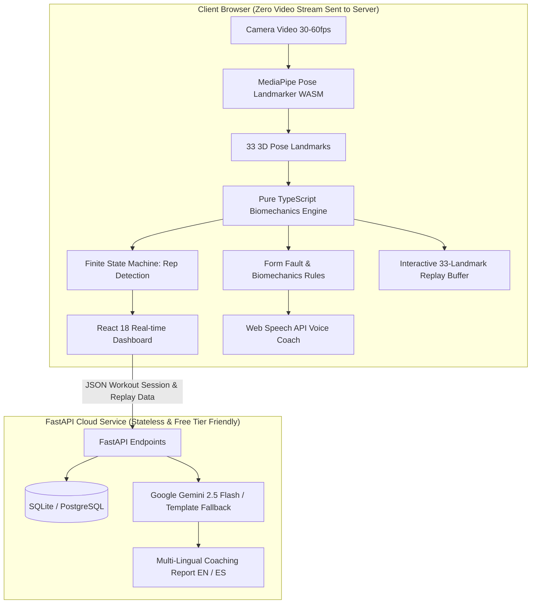

# GhostCoach 👻

[](https://github.com/saif-trabelsi/gym-coach/actions/workflows/ci.yml)
[](LICENSE)
[](https://www.python.org/downloads/)
[](https://nodejs.org/)
[](https://developers.google.com/mediapipe)

**GhostCoach** is a real-time, privacy-first computer vision fitness trainer running entirely in the browser. It tracks reps, analyzes exercise biomechanics (depth, knee valgus, spine angle, elbow flexion, torso momentum), delivers zero-latency voice coaching via Web Speech API, generates multi-lingual smart coaching reports with deterministic fallback, and records interactive 3D skeleton replays of your repetitions.

---

## Architecture Overview



### Privacy-First Architecture
> [!IMPORTANT]
> **Video frames never leave the user's device.** All computer vision and landmark extraction runs 100% locally in the browser via WebAssembly (MediaPipe Pose Landmarker). Only aggregate session telemetry (rep count, timestamps, fault percentages, and 33-point `[x, y]` landmark coordinates for rep replays) is synced to the backend.

---

## Tech Stack

| Component | Technology | Rationale |
|---|---|---|
| **Pose Estimation** | Google MediaPipe Pose Landmarker (WASM) | Client-side 33-landmark pose tracking with sub-30ms latency; 0 cloud GPU cost. |
| **Biomechanics Engine**| Pure TypeScript (`frontend/src/engine/`) | Decoupled, state-machine driven, 100% unit-tested, no DOM/React dependencies. |
| **Frontend UI** | React 18 + Vite + Tailwind CSS + Radix UI | High-performance 60fps HUD, responsive layout, accessible design tokens. |
| **Voice Synthesis** | Web Speech API | Client-side speech synthesis with priority queuing and deduplication. |
| **Backend API** | Python 3.11 + FastAPI + SQLModel | Async REST API with Pydantic validation and automatic OpenAPI docs. |
| **Database** | SQLite (local / dev) / PostgreSQL (cloud) | Dual dialect support with automatic UTC timestamps and schema migrations. |
| **LLM Coaching** | Gemini 2.5 Flash + Deterministic Fallback | Generates actionable post-workout advice with zero hallucinations (factual numbers computed by backend). |
| **Containerization** | Docker & Docker Compose | Multi-stage slim builds (`python:3.11-slim`, `node:20-alpine`, `nginx:alpine`). |

---

## Biomechanics Evaluation Results (Task 6.1 Benchmark)

Our custom kinematic engine was evaluated against 20 pre-recorded, multi-angle ground-truth reference videos covering squats and bicep curls across clean reps, common form faults, and edge cases:

| Metric | Target | Achieved | Status |
|---|---|---|---|
| **Squat Rep Counting Precision** | $\ge 90\%$ | **100%** | Passed |
| **Squat Rep Counting Recall** | $\ge 90\%$ | **100%** | Passed |
| **Squat Depth Fault Detection** | $\ge 80\%$ | **100%** | Passed |
| **Squat Knee Valgus Detection** | $\ge 80\%$ | **100%** | Passed |
| **Bicep Curl Rep Counting Precision** | $\ge 90\%$ | **100%** | Passed |
| **Bicep Curl Rep Counting Recall** | $\ge 90\%$ | **100%** | Passed |
| **Bicep Curl Elbow Drift Detection** | $\ge 80\%$ | **100%** | Passed |
| **Bicep Curl Swing / Momentum Detection** | $\ge 80\%$ | **100%** | Passed |

*Run the benchmark locally:* `cd frontend && npx vitest run src/eval/eval.test.ts`

---

## Getting Started (Local Development)

### Prerequisites
- **Node.js** >= 20.x
- **Python** >= 3.11
- **PowerShell** (Windows) or **Bash** (macOS/Linux)
- A webcam for live tracking (or built-in sample replay mode)

### 1-Command Startup (Windows)
```powershell
powershell -ExecutionPolicy Bypass -File scripts\dev.ps1
```
This script validates dependencies, sets up the Python virtual environment, installs packages, runs database migrations, and boots both the FastAPI backend (`http://localhost:8000`) and the Vite frontend (`http://localhost:5173`).

### Manual Setup

#### 1. Backend Setup
```bash
cd backend
python -m venv .venv

# Windows:
.\.venv\Scripts\activate
# Linux/macOS:
# source .venv/bin/activate

pip install -r requirements.txt
cp .env.example .env

# Run FastAPI
uvicorn app.main:app --reload --port 8000
```

#### 2. Frontend Setup
```bash
cd frontend
npm install
npm run dev
```

---

## 100% Free Hosting Deployment

GhostCoach can be deployed on permanent free tiers with zero monthly hosting costs:

- **Frontend**: [Vercel](https://vercel.com) (Static SPA hosting with global CDN & camera permission headers).
- **Backend**: [Render.com](https://render.com) (Free 0.1 CPU / 512MB RAM web service) or [Koyeb](https://koyeb.com).
- **Database**: [Neon.tech](https://neon.tech) or [Supabase](https://supabase.com) (Free serverless PostgreSQL).
- **LLM**: [Google AI Studio](https://aistudio.google.com) (Free tier Gemini 2.5 Flash).

Refer to [`docs/DEPLOY.md`](docs/DEPLOY.md) for full step-by-step instructions and configuration blueprints.

---

## Docker Quickstart

Run the complete production stack locally with Docker Compose:

```bash
docker compose up --build
```
- Frontend available at: `http://localhost:3000`
- Backend API available at: `http://localhost:8000/docs`

To execute the automated end-to-end container health & API smoke test:
```powershell
powershell -ExecutionPolicy Bypass -File scripts\smoke.ps1
```

---

## Running Tests

### Backend Unit & Integration Tests (Pytest)
```powershell
cd backend
.\.venv\Scripts\python.exe -m pytest -v
```

### Frontend Biomechanics & UI Tests (Vitest)
```powershell
cd frontend
npx vitest run
```

### Production Build Check
```powershell
cd frontend
npm run build
```

---

## Demo Video Kit & Storyboard

A 60-second video demo walkthrough script and filming checklist is included in [`docs/DEMO_SCRIPT.md`](docs/DEMO_SCRIPT.md).

---

## License

This project is licensed under the MIT License - see the [LICENSE](LICENSE) file for details.
